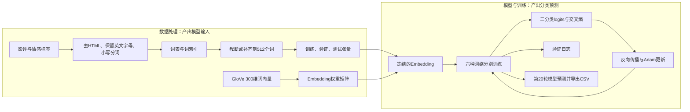

# IMDB情感分析：GloVe与六种网络的学习记录

这次练习把影评从原始文本变成模型输入，再完成训练、验证和预测导出。六个模型都已跑完20轮，原Notebook保留了代码、每轮结果与导出记录。

**实验运行时间：2026-09-12 19:54—20:56（北京时间）**，来自Notebook的papermill元数据。**整理归档日期：2026-10-11**。这两个日期分别表示运行和归档时间。

## 材料入口

- [原始Notebook：代码与完整运行输出](notebooks/imdb-glove-six-models-2026-09-12.ipynb)
- [六模型结果汇总](metrics/model_summary.csv)
- [全部120条逐轮指标](metrics/training_history.csv)
- [此前的六模型实战与概念问答](../IMDB六模型实战与概念问答.md)：历史对话整理，包含另一份5轮实验的排行榜成绩，不能与本次验证日志混用。

Notebook仅重命名归档，训练代码和输出没有修改。本次没有重跑训练。指标表直接从原日志提取，精度保留到日志打印的4位小数。

## 1. 整个流程做了什么

数据处理负责把文本转换成数字，模型负责把这些数字转换成两个类别的分数。导出的`sentiment`通过`argmax`得到，是0/1类别，而不是正类概率。

## 2. 数据和共同实验条件

| 项目 | 原Notebook中的设置 |
| --- | --- |
| 任务 | Kaggle Bag of Words Meets Bags of Popcorn，IMDB影评正负情感二分类 |
| 数据文件 | `labeledTrainData.tsv`、无标签的`testData.tsv`；本次没有使用`unlabeledTrainData.tsv` |
| 划分 | 有标签数据按80%/20%划分训练与验证，`random_state=0`，未设置分层抽样 |
| 文本清洗 | BeautifulSoup去HTML，非英文字母替换为空格，小写并分词；未删除停用词 |
| 词表 | 101,399个词，来自全部有标签文本与测试文本的并集 |
| 输入长度 | 最长512个词，过长截断，过短在尾部补0 |
| 词向量 | GloVe 840B 300d，六个模型都冻结Embedding；未匹配词向量的词保持零向量 |
| 训练 | batch size 64，Adam，学习率0.001，交叉熵，每个模型20轮 |
| 设备 | 实际单元输出为`cuda:0`；元数据中的GPU开关不能替代实际运行输出 |
| 测试预测 | 校验25,000条预测及ID顺序，使用样本提交模板导出六份CSV |

词索引0同时用作未知词与padding。词表在划分前建立，看到了验证集和无标签测试集中的词汇；构建词表时没有使用验证标签，但它也不是严格只用训练子集构建词表的设置。验证标签用于后续评估，测试文件没有提供标签。

## 3. 六种模型与结果

这些数值是**Notebook打印的验证batch平均准确率**。每个batch的准确率被等权平均，末尾不足64条的batch与完整batch权重相同，因此不等于精确的全验证集样本准确率。

| 模型 | 核心结构 | 最高验证日志 | 最高值轮数 | 第20轮验证日志 |
| --- | --- | ---: | --- | ---: |
| CNN | 128个宽度3的卷积核，ReLU，全局最大池化 | 0.8977 | 7、10、11、15、20 | 0.8977 |
| BiLSTM | 2层双向LSTM，隐藏维度128，拼接首尾时间步输出 | 0.8995 | 10 | 0.8916 |
| BiGRU | 2层双向GRU，隐藏维度128，拼接首尾时间步输出 | **0.9031** | 8 | 0.8942 |
| Attention-BiLSTM | 双向LSTM后计算注意力权重，再沿时间维加权求和 | 0.9021 | 4、5 | 0.8948 |
| CNN-BiLSTM | 卷积提取局部特征，再送入双向LSTM | 0.8983 | 8 | 0.8756 |
| TransformerEncoder | 300→128投影，2层编码器、8个头，序列平均池化 | 0.8869 | 4 | 0.8661 |

本次单次运行中，GRU的最高验证日志为90.31%。代码没有保存最佳检查点，而是在20轮训练完成后直接返回模型，所以**六份预测CSV使用的都是第20轮模型**，不能把表中的最高值写成实际导出模型的分数。

本Notebook没有排行榜成绩、提交回执或测试标签。`saved: result/*.csv`证明预测文件已生成，不能据此证明本次已提交Kaggle，更不能当作隐藏测试集成绩。CSV内容本身没有嵌入Notebook，本目录的两个CSV是日志指标表。

## 4. 从代码中接触到的具体内容

### 文本表示与张量维度

词索引只表示词在词表中的位置，不表示词义。Embedding查表后，每个词对应一个300维向量，形状由`(batch, 512)`变成`(batch, 512, 300)`。

CNN的`Conv1d`需要通道维在中间，因此先转换成`(batch, 300, 512)`。LSTM与GRU使用默认的时间维在前格式，转换成`(512, batch, 300)`。这些`permute`调整的是维度顺序，不是新增网络层或改变词义。

### 共用训练闭环

`zero_grad → forward → CrossEntropyLoss → backward → step`构成一次参数更新。六个网络共用同一训练函数，区别主要在`forward`中的表示提取。验证时调用`eval()`和`no_grad()`，将验证与训练的行为分开。

分类器输出两个logits，损失函数内部处理softmax对应的计算；预测时再取最大分数所在的类别。Embedding被冻结，上层网络和分类器仍然参与训练。

### 注意力怎样聚合序列

原实现对双向LSTM每个时间步的输出`h_t`计算一个分数，沿时间维做softmax，再加权求和。这里是对一个序列的状态进行加权汇总，不是Transformer中的多头自注意力。

$$
e_t=u^{\mathsf T}\tanh(W^{\mathsf T}h_t),\qquad
a_t=\frac{\exp(e_t)}{\sum_j\exp(e_j)},\qquad
c=\sum_t a_t h_t.
$$

`h_t`是256维双向状态，`W`是256×256的可训练矩阵，`u`是256维可训练向量；`e_t`是标量，`a_t`是归一化权重，`c`仍是256维向量。公式以列向量记号表达原代码的行向量计算，参数转置方向相应调整。它对应了注意力模块从“每个位置有一个分数”到“得到整段影评表示”的过程。

运行过这些模块是动手成果，不能直接写成已经系统掌握了LSTM、注意力和Transformer的全部原理。后续仍需要结合D2L按需学习，解释每一步的计算。

## 5. 已处理的问题和仍待改进的地方

原训练函数的注释保留了修复记录，包括初始化batch计数、修正损失函数变量、修正`.cpu()`调用和返回模型。Attention-LSTM的分类头改为256维，CNN-LSTM的输入维度改为卷积输出的128维。六个模型均有完整训练与预测成功输出，说明这些代码路径在当次运行中已跑通。

| 观察或问题 | 依据与目前状态 | 后续处理方向 |
| --- | --- | --- |
| 后期训练分数升高，验证分数回落 | GRU训练准确率从第8轮0.9723升到第20轮0.9947，验证日志从0.9031降到0.8942；符合过拟合的常见表现，但没有多次运行确认 | 保存最佳验证检查点，加入早停，再做固定条件对照 |
| 准确率统计不够准确 | 训练函数对batch准确率等权平均 | 按正确样本总数除以样本总数统计；新统计须重新评估，不能反推旧分数 |
| padding参与状态与聚合 | 循环网络没有按真实长度pack；注意力没有屏蔽padding | 分开PAD/UNK，记录真实长度，加入相应mask或pack |
| 简化Transformer缺少位置与padding处理 | 无位置编码、无`src_key_padding_mask`，平均池化也包括padding | 补齐位置编码、padding mask与有效位置池化后重新训练比较 |
| 改长度参数会出现不一致 | `pad_samples`截断用`maxlen`，补齐却引用全局`max_len`；默认512时可运行 | 改进版统一使用函数参数 |
| 结果复现条件不完整 | 只固定划分种子，没有固定训练种子；词表来自无序set；没有保存模型权重 | 固定词表顺序与随机种子，保存配置、映射和权重 |
| GloVe读取产生warning | 有重复词警告和NumPy数组不可写警告，训练未中断 | 保留警告记录，检查向量来源；转换时可显式复制数组 |

上述问题本次只做核对与记录，没有改动历史Notebook，也没有把旧日志附到新代码上。特别是该Transformer为学习用的随机初始化编码器，不是BERT；本次结果不能代表完整Transformer方案的能力。

## 6. 下一步接着做什么

先把一次训练与验证闭环讲清楚：输入是什么形状、哪些参数更新、验证如何统计、最终采用哪一轮模型。然后用已有代码对应D2L中的注意力、位置编码和mask，逐项补齐；改进版本另存，重新运行后再比较结果。

BERT实验此前已经完成到训练与预测，但**这份附件不包含BERT代码与结果**，此处不补写BERT分数。六模型学习记录与BERT微调材料应按实际来源分别归档。

**下一项自主练习**：选择CNN的一批样本，先不看训练函数，写出“词索引→Embedding→卷积→池化→分类分数→损失→梯度→更新”的调用顺序和关键形状，再与原代码对照。自测标准是能说明`backward()`和`step()`分别做什么、冻结Embedding后哪些参数仍更新，以及为什么最后一个小batch不能与完整batch等权计入全样本准确率。此项是后续练习，不记为已经完成。

## 7. 来源与运行说明

- 实验依据为本目录原Notebook。数据处理见原第10—28个单元，训练与导出见第33—37个单元，六个模型与日志见第39—44个单元；编号按原Notebook从1开始计数。
- Notebook SHA-256：`25a616584a4201c7ed62fb933729891e1f3ee8b774815ddc29c62da4b52d5ea7`。
- [Kaggle比赛入口](https://www.kaggle.com/c/word2vec-nlp-tutorial)。运行需挂载比赛数据，并保留样本提交模板。
- [GloVe官方说明与预训练向量](https://nlp.stanford.edu/projects/glove/)。本Notebook使用`glove.840B.300d.txt`，通过Kaggle数据集挂载；GloVe大文件、数据TSV、pickle缓存和权重不在此归档中。
- [PyTorch TransformerEncoder接口](https://docs.pytorch.org/docs/stable/generated/torch.nn.TransformerEncoder.html)支持传入`src_key_padding_mask`；是否传入应以本Notebook实际代码为准，当前没有传入。

在Kaggle按Notebook顺序运行，需开启GPU并允许安装所需依赖。代码含固定的Kaggle输入路径，迁移到本地需调整路径。原文件没有完整锁定依赖版本，因此保留输出不等于保证在任意新环境逐字复现同样的分数。
