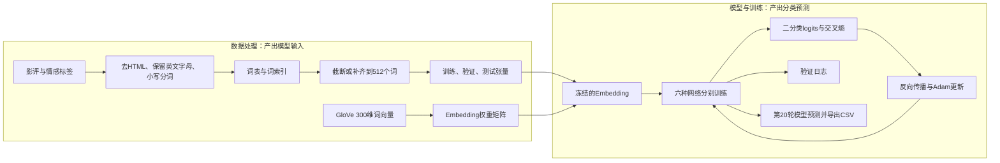

# IMDB情感分析：六模型实验、Kaggle提交与预训练模型扩展

这次练习把影评从原始文本变成模型输入，再完成训练、验证和预测导出。六个模型都已跑完20轮，原Notebook保留了代码、每轮结果与导出记录。

**实验运行时间：2026-09-12 19:54—20:56（北京时间）**，来自Notebook的papermill元数据。**整理归档日期：2026-10-11**。这两个日期分别表示运行和归档时间。

## 材料入口

- [原始Notebook：代码与完整运行输出](notebooks/imdb-glove-six-models-2026-09-12.ipynb)
- [新增Kaggle Notebook：BERT、DeBERTa-v2-xxlarge与LoRA](notebooks/imdb-bert-deberta-lora.ipynb)
- [预训练模型共用代码](code/imdb_pretrained.py)与[依赖版本](code/requirements-pretrained.txt)
- [六模型结果汇总](metrics/model_summary.csv)
- [全部120条逐轮指标](metrics/training_history.csv)
- [Kaggle提交记录：15条，保留版本与来源](metrics/kaggle_submissions.csv)
- [此前的六模型实战与概念问答](../IMDB六模型实战与概念问答.md)：历史对话整理，包含另一份5轮实验的排行榜成绩，不能与本次验证日志混用。

原Notebook的代码、输出与元数据均保留；网页归档在文件末尾补了一个换行。本次没有重跑原实验。指标表直接从原日志提取，精度保留到日志打印的4位小数。

## 1. 整个流程做了什么

数据处理负责把文本转换成数字，模型负责把这些数字转换成两个类别的分数。导出的`sentiment`通过`argmax`得到，是0/1类别，而不是正类概率。

## 2. 数据和共同实验条件

| 项目 | 原Notebook中的设置 |
| --- | --- |
| 任务 | Kaggle Bag of Words Meets Bags of Popcorn，IMDB影评正负情感二分类 |
| 数据文件 | `labeledTrainData.tsv`、无标签的`testData.tsv`；本次没有使用`unlabeledTrainData.tsv` |
| 划分 | 有标签数据按80%/20%划分训练与验证，`random_state=0`，未设置分层抽样 |
| 文本清洗 | BeautifulSoup去HTML，非英文字母替换为空格，小写并分词；未删除停用词 |
| 词表 | 101,399个词，来自全部有标签文本与测试文本的并集 |
| 输入长度 | 最长512个词，过长截断，过短在尾部补0 |
| 词向量 | GloVe 840B 300d，六个模型都冻结Embedding；未匹配词向量的词保持零向量 |
| 训练 | batch size 64，Adam，学习率0.001，交叉熵，每个模型20轮 |
| 设备 | 实际单元输出为`cuda:0`；元数据中的GPU开关不能替代实际运行输出 |
| 测试预测 | 校验25,000条预测及ID顺序，使用样本提交模板导出六份CSV |

词索引0同时用作未知词与padding。词表在划分前建立，看到了验证集和无标签测试集中的词汇；构建词表时没有使用验证标签，但它也不是严格只用训练子集构建词表的设置。验证标签用于后续评估，测试文件没有提供标签。

## 3. 六种模型与结果

这些数值是**Notebook打印的验证batch平均准确率**。每个batch的准确率被等权平均，末尾不足64条的batch与完整batch权重相同，因此不等于精确的全验证集样本准确率。

| 模型 | 核心结构 | 最高验证日志 | 最高值轮数 | 第20轮验证日志 |
| --- | --- | ---: | --- | ---: |
| CNN | 128个宽度3的卷积核，ReLU，全局最大池化 | 0.8977 | 7、10、11、15、20 | 0.8977 |
| BiLSTM | 2层双向LSTM，隐藏维度128，拼接首尾时间步输出 | 0.8995 | 10 | 0.8916 |
| BiGRU | 2层双向GRU，隐藏维度128，拼接首尾时间步输出 | **0.9031** | 8 | 0.8942 |
| Attention-BiLSTM | 双向LSTM后计算注意力权重，再沿时间维加权求和 | 0.9021 | 4、5 | 0.8948 |
| CNN-BiLSTM | 卷积提取局部特征，再送入双向LSTM | 0.8983 | 8 | 0.8756 |
| TransformerEncoder | 300→128投影，2层编码器、8个头，序列平均池化 | 0.8869 | 4 | 0.8661 |

本次单次运行中，GRU的最高验证日志为90.31%。代码没有保存最佳检查点，而是在20轮训练完成后直接返回模型，所以**六份预测CSV使用的都是第20轮模型**，不能把表中的最高值写成实际导出模型的分数。

原Notebook本身没有排行榜成绩、提交回执或测试标签。`saved: result/*.csv`记录了预测导出，CSV内容没有嵌入Notebook。现已根据补充提供的Kaggle提交列表归档提交分数，见下表；这些分数与验证日志属于两种评价来源。

### Kaggle实际提交结果

以下分数来自2026-10-11补充提供的提交列表。保留原始五位小数，记为 **Kaggle ROC-AUC**，不改称本地验证准确率。[比赛评分说明](https://www.kaggle.com/competitions/word2vec-nlp-tutorial/overview/evaluation)明确以ROC曲线下面积评分；指标表中的`kaggle_score`也对应此指标。0.89996不能直接写成准确率89.996%。版本链接能定位Notebook版本；一个版本可对应多份不同模型的提交文件。原列表的“1mo ago”不构成准确提交日期，故不据此补写日期。

| 模型 | Version 2 · 349236507 | 修复ATTLSTM · 349247611 | epoch=20 · 349264392 |
| --- | ---: | ---: | ---: |
| CNN | 0.88880 | — | 0.89088 |
| BiLSTM | 0.89128 | — | 0.89368 |
| BiGRU | **0.89996** | — | 0.89320 |
| Attention-BiLSTM | 0.50004 | **0.89660** | **0.89388** |
| CNN-BiLSTM | 0.88580 | — | 0.87208 |
| TransformerEncoder | 0.86944 | — | 0.85216 |

- [Version 2](https://www.kaggle.com/code/plpany/bag-of-words-meets-bags-of-popcorn-by-the-imdb?scriptVersionId=349236507)：六条标明模型的记录，另有一条未标明模型的0.88580；后者单独保留，不根据分数相同就认定是CNN-BiLSTM。
- [修复ATTLSTM](https://www.kaggle.com/code/plpany/bag-of-words-meets-bags-of-popcorn-by-the-imdb?scriptVersionId=349247611)：0.89660。对照原版本0.50004，说明修复后成绩明显恢复；提交列表不能单独证明具体是哪一处代码导致了变化。
- [epoch=20](https://www.kaggle.com/code/plpany/bag-of-words-meets-bags-of-popcorn-by-the-imdb?scriptVersionId=349264392)：六条标明模型的记录。此组最高是ATTLSTM的0.89388。
- [Version 1](https://www.kaggle.com/code/plpany/bag-of-words-meets-bags-of-popcorn-by-the-imdb?scriptVersionId=348564596)：0.88400，原列表未标明模型。

现有提交记录中，最高分为Version 2的GRU：0.89996。GRU、CNN-LSTM与简化Transformer在20轮版本中的提交分数均低于Version 2，ATTLSTM也低于单独修复版本；增加训练轮数并未带来一致提高。结合原Notebook后期验证分数回落，过拟合是值得检查的解释，但不同版本还可能改变了代码、随机状态与配置，不能把分数差值直接当作仅由epoch导致的效果。

20轮提交列表和原Notebook都表明使用了训练结束后的模型，但当前没有每份提交CSV及其哈希，尚不能逐字核对其与附件导出文件的对应关系。训练日志、提交分数和版本编号分别保留，便于后续追溯。

## 4. 从代码中接触到的具体内容

### 文本表示与张量维度

词索引只表示词在词表中的位置，不表示词义。Embedding查表后，每个词对应一个300维向量，形状由`(batch, 512)`变成`(batch, 512, 300)`。

CNN的`Conv1d`需要通道维在中间，因此先转换成`(batch, 300, 512)`。LSTM与GRU使用默认的时间维在前格式，转换成`(512, batch, 300)`。这些`permute`调整的是维度顺序，不是新增网络层或改变词义。

### 共用训练闭环

`zero_grad → forward → CrossEntropyLoss → backward → step`构成一次参数更新。六个网络共用同一训练函数，区别主要在`forward`中的表示提取。验证时调用`eval()`和`no_grad()`，将验证与训练的行为分开。

分类器输出两个logits，损失函数内部处理softmax对应的计算；预测时再取最大分数所在的类别。Embedding被冻结，上层网络和分类器仍然参与训练。

### 注意力怎样聚合序列

原实现对双向LSTM每个时间步的输出`h_t`计算一个分数，沿时间维做softmax，再加权求和。这里是对一个序列的状态进行加权汇总，不是Transformer中的多头自注意力。

$$
e_t=u^{\mathsf T}\tanh(W^{\mathsf T}h_t),\qquad
a_t=\frac{\exp(e_t)}{\sum_j\exp(e_j)},\qquad
c=\sum_t a_t h_t.
$$

`h_t`是256维双向状态，`W`是256×256的可训练矩阵，`u`是256维可训练向量；`e_t`是标量，`a_t`是归一化权重，`c`仍是256维向量。公式以列向量记号表达原代码的行向量计算，参数转置方向相应调整。它对应了注意力模块从“每个位置有一个分数”到“得到整段影评表示”的过程。

运行过这些模块是动手成果，不能直接写成已经系统掌握了LSTM、注意力和Transformer的全部原理。后续仍需要结合D2L按需学习，解释每一步的计算。

## 5. 已处理的问题和仍待改进的地方

原训练函数的注释保留了修复记录，包括初始化batch计数、修正损失函数变量、修正`.cpu()`调用和返回模型。Attention-LSTM的分类头改为256维，CNN-LSTM的输入维度改为卷积输出的128维。六个模型均有完整训练与预测成功输出，说明这些代码路径在当次运行中已跑通。

| 观察或问题 | 依据与目前状态 | 后续处理方向 |
| --- | --- | --- |
| 后期训练分数升高，验证分数回落 | GRU训练准确率从第8轮0.9723升到第20轮0.9947，验证日志从0.9031降到0.8942；符合过拟合的常见表现，但没有多次运行确认 | 保存最佳验证检查点，加入早停，再做固定条件对照 |
| 准确率统计不够准确 | 训练函数对batch准确率等权平均 | 按正确样本总数除以样本总数统计；新统计须重新评估，不能反推旧分数 |
| padding参与状态与聚合 | 循环网络没有按真实长度pack；注意力没有屏蔽padding | 分开PAD/UNK，记录真实长度，加入相应mask或pack |
| 简化Transformer缺少位置与padding处理 | 无位置编码、无`src_key_padding_mask`，平均池化也包括padding | 补齐位置编码、padding mask与有效位置池化后重新训练比较 |
| 改长度参数会出现不一致 | `pad_samples`截断用`maxlen`，补齐却引用全局`max_len`；默认512时可运行 | 改进版统一使用函数参数 |
| 结果复现条件不完整 | 只固定划分种子，没有固定训练种子；词表来自无序set；没有保存模型权重 | 固定词表顺序与随机种子，保存配置、映射和权重 |
| GloVe读取产生warning | 有重复词警告和NumPy数组不可写警告，训练未中断 | 保留警告记录，检查向量来源；转换时可显式复制数组 |

上述问题本次只做核对与记录，没有改动历史Notebook，也没有把旧日志附到新代码上。特别是该Transformer为学习用的随机初始化编码器，不是BERT；本次结果不能代表完整Transformer方案的能力。

## 6. 新增BERT、DeBERTa与LoRA代码

扩展版已经编写，独立于原六模型Notebook。**已收到BERT全量微调的真实Kaggle训练日志；BERT LoRA与DeBERTa本次结果尚未提供。** 此前另一次BERT训练的进展以实际材料为准，不能把它的成绩移到这份新代码上。

仍然采用共用训练、验证和预测函数。预训练模型需要独立的子词tokenizer，因此不能把模型直接接到原GloVe词索引上；扩展版把底座和tokenizer配对，修改`MODEL_KEY`即可切换。

| MODEL_KEY | 底座与训练方式 | 默认batch / 长度 / 累积 |
| --- | --- | --- |
| `bert_full` | `bert-base-uncased`，全量微调 | 8 / 256 / 2 |
| `bert_lora` | 同一BERT，query/value上加LoRA，同时训练分类头 | 8 / 256 / 2 |
| `deberta_v2_xxlarge` | `microsoft/deberta-v2-xxlarge`，默认FP16冻结底座，以LoRA微调query_proj/value_proj，训练pooler及classifier | 1 / 128 / 16 |

LoRA训练低秩权重增量：

$$W=W_0+\frac{\alpha}{r}BA,\qquad A\in\mathbb{R}^{r\times k},\quad B\in\mathbb{R}^{d\times r}.$$

`W_0`冻结，`A`与`B`更新。这里的`r=8`是增量矩阵的秩，不是8条规则，也不是把输入文本直接降到8维。DeBERTa有新建的任务pooler与分类头，两者一并训练和保存；可训练部分保持FP32，以配合FP16混合精度。

### 直接在Kaggle运行：需要哪些输入

下载[新增Notebook](notebooks/imdb-bert-deberta-lora.ipynb)，用 **Import Notebook** 导入Kaggle。它已完整嵌入模型代码与数据检查；无需另外上传Python脚本。

在 **Input → Add Input → Competitions** 搜索并添加 **Bag of Words Meets Bags of Popcorn（word2vec-nlp-tutorial）**。如要求接受比赛规则，先接受；导入Notebook不会自动添加数据或开启GPU。

| 必需文件 | 用途 | 行数 |
| --- | --- | ---: |
| `labeledTrainData.tsv.zip`，或解压后的`labeledTrainData.tsv` | 带0/1标签的影评，划分训练与验证集 | 25,000 |
| `testData.tsv.zip`，或解压后的`testData.tsv` | 待预测的测试影评 | 25,000 |
| `sampleSubmission.csv` | 提交ID和顺序模板 | 25,000 |

添加[整个比赛数据](https://www.kaggle.com/competitions/word2vec-nlp-tutorial/data)即可，无需解压。`unlabeledTrainData.tsv.zip`本次不使用；**新版本不需要GloVe、pickle缓存、原Notebook输出或Hugging Face登录凭据**。

1. 在设置中开启 **Internet**，选择 **GPU T4 ×2**。依赖、tokenizer和公开模型权重会自动联网下载；保留Kaggle已有的CUDA版PyTorch。
2. 默认`MODEL_KEY="bert_full"`、`SMOKE_ONLY=False`，**Run All直接完整训练3轮**，按20,000/5,000划分验证，再导出25,000条预测。一次运行一种方法。
3. 切换方法只需修改Notebook第7节的`MODEL_KEY`：`bert_full`、`bert_lora`或`deberta_v2_xxlarge`。默认XXL是LoRA微调；首次检查显存时可把`SMOKE_ONLY=True`，但其16条小样本预测不能提交比赛，完整训练要改回`False`。
4. 下载并保留`/kaggle/working/result/本次运行目录/`：逐轮指标、配置与版本、数据来源、划分索引、最佳检查点、预测CSV、正类概率和显存峰值。使用其中的`submission.csv`提交；生成文件不会自动提交Kaggle。

第1节在安装依赖、下载模型之前先检查输入：优先定位官方比赛目录，同时支持普通文件和ZIP；校验三份数据各25,000行、必需列、0/1标签、非空文本、唯一ID以及测试/模板ID集合。模板顺序不同允许通过，预测时会按模板顺序重排。缺数据、多份来源或坏输入会立即报出原因；自定义输入目录可在第1节填写`DATA_DIR`。

原划分默认80%/20%、`random_state=0`、不分层；训练随机种子42。全量BERT与BERT LoRA共用默认长度和batch，学习率也先统一为`2e-5`。完整训练按验证AUC选最佳轮次，小样本试跑按accuracy选；训练结束恢复最佳参数再预测。验证准确率按样本计数，梯度累积的末尾不足一组也正确更新。

默认`submission.csv`保留0/1的`sentiment`，与原代码和比赛教程一致；另一个概率文件用`positive_probability`列保存正类概率，供AUC与错例分析。若以后比较概率提交，先转换为比赛要求的`id,sentiment`两列，并把预测方式记入实验条件；不能混用两种CSV的分数。生成预测不会自动提交Kaggle。

### 双T4的显存边界

本次目标设备是Kaggle的两张T4，每张16GB；代码一次选一张，`DEVICE="cuda:0"`或`"cuda:1"`。第二张卡不会自动被使用，普通数据并行也不会把显存合成一张32GB卡。

指定的DeBERTa-v2-xxlarge约1.5B参数、48层、隐藏维度1536。冻结底座用FP16时，权重粗估约3GB，但训练还需要激活、临时张量与可训练部分，因此LoRA不等于绝不会爆显存。默认长度128、batch 1、累积16并开启梯度检查点，先在T4试跑实测峰值，再考虑增加长度。[官方模型卡](https://huggingface.co/microsoft/deberta-v2-xxlarge)、[T4规格](https://www.nvidia.com/en-us/data-center/tesla-t4/)

`xxl_mode="head_only"`可做仅训练pooler/classifier的基线；`xxl_mode="full"`保留全量入口，需显式开启`allow_xxl_full`且默认要求单卡至少40GiB空闲显存。当前双T4不满足这个全量模式的单卡条件。默认XXL LoRA没有换成较小底座，也没有实现量化或多卡分片。

### 目前验证到了哪里

本地CPU以随机初始化的小BERT和DeBERTa-v2完成12项检查：全量/LoRA参数更新、任务层保存、最佳检查点恢复与重载、末尾梯度累积、按样本统计指标、AUC选择与单类别边界、预测ID顺序和概率输出均通过。真实BERT与DeBERTa-v2-xxlarge分词器也已检查，并补齐SentencePiece转换所需的protobuf依赖。上述本地检查未下载真实大模型权重。随后补充的Kaggle日志已确认BERT完成全量数据训练，峰值显存见下；LoRA和DeBERTa的GPU情况仍需对应的实际运行记录。

| 新实验 | 验证accuracy / AUC | 最佳轮次 | 显存峰值 | Kaggle AUC |
| --- | --- | --- | --- | --- |
| BERT全量 | 0.9128 / 0.9736733349381915 | 3（按AUC） | allocated 2.73GiB / reserved 2.88GiB | 提交结果未提供 |
| BERT LoRA | 运行结果未提供 | 运行结果未提供 | 显存记录未提供 | 提交结果未提供 |
| DeBERTa-v2-xxlarge LoRA | 运行结果未提供 | 运行结果未提供 | 显存记录未提供 | 提交结果未提供 |

### BERT全量：Kaggle实际训练结果

2026-10-11收到运行日志，来源是本人粘贴的Kaggle输出；这是日志提供日期，执行时间未提供。[三轮指标CSV](metrics/bert_full_kaggle_report_2026-10-11.csv)保留表格显示精度。尚未取得本次保存的Notebook、提交CSV和完整配置文件，未填Kaggle排行榜分数。

底座为`bert-base-uncased`，训练方式`full_fine_tuning`，109,483,778个参数全部参与训练；每轮20,000条训练影评、5,000条验证影评，共3轮。

| epoch | 训练loss | 训练accuracy | 验证loss | 验证accuracy | 验证AUC |
| --- | ---: | ---: | ---: | ---: | ---: |
| 1 | 0.288101 | 0.88305 | 0.228602 | 0.9090 | 0.972725 |
| 2 | 0.171451 | 0.94770 | 0.250490 | **0.9140** | 0.973270 |
| 3 | 0.105459 | 0.97265 | 0.350316 | 0.9128 | **0.973673** |

日志选中第3轮：验证loss的完整输出为`0.35031609143540265`，AUC为`0.9736733349381915`，accuracy为`0.9128`。按`monitor="auc"`选择最大验证AUC是当前规则，第2轮准确率最高不改变该选择。峰值allocated为2.73GiB，reserved为2.88GiB；这是本次BERT训练的PyTorch统计，不是所有模型的显存保证。

训练loss持续降低而验证loss上升，已有过拟合迹象；AUC仍有小幅提高。AUC衡量排序，交叉熵还受预测置信程度影响，两者可以同时出现；单次日志没有错例和概率分布，暂不能确定具体哪些影评导致损失上升。三轮AUC总增幅约0.00095，还需多次运行评估稳定性。

原提交记录是Kaggle测试集ROC-AUC；本次0.973673是5,000条验证影评上的ROC-AUC，评价数据不同，不直接与历史0.89996相减来宣称排行榜提升。预测导出和比赛提交的完成状态也需各自的结果确认。

加载报告中的`cls.predictions.*`与`cls.seq_relationship.*`属于旧预训练任务头，本次不使用；`classifier.weight/bias`为新建情感分类头，随后参与微调。这一组UNEXPECTED/MISSING符合任务头替换。[Transformers加载说明](https://huggingface.co/docs/transformers/main_classes/model)

每轮`optimizer_steps=1249`。若沿用默认batch=8、梯度累积2，每轮尝试更新1,250次；代码只统计AMP成功更新，符合每轮有一次跳步。可在`training_metadata.json`核对`skipped_amp_steps`，三轮按此配置预期为3；每轮`train_examples=20000`说明并非漏读一条训练batch。[PyTorch AMP机制](https://docs.pytorch.org/docs/stable/notes/amp_examples.html)

接下来先核对本次最佳模型的25,000条预测导出与Kaggle提交结果，再在同一划分下运行BERT LoRA，比较验证AUC、accuracy、可训练参数量和显存峰值。

先完成同底座BERT的全量/LoRA对照，再单独记录DeBERTa结果。预训练模型、分词方式与默认长度同时变化时，不能把分数差全部归因于LoRA。新版本的数学含义、训练参数量和实际实验结果接起来之后，再判断是否需要调秩、长度或学习率。

方法与实现依据：[PEFT LoRA配置](https://huggingface.co/docs/peft/en/package_reference/lora)、[混合精度问题处理](https://huggingface.co/docs/peft/en/developer_guides/troubleshooting)、[DeBERTa-v2分类实现](https://github.com/huggingface/transformers/blob/main/src/transformers/models/deberta_v2/modeling_deberta_v2.py)。依赖固定Transformers 5.19.0 / PEFT 0.21.2 / Accelerate 1.15.0；Kaggle保留CUDA版PyTorch≥2.6。本地检查使用PyTorch 2.14.1 CPU版，这不是Kaggle安装要求。

## 7. 来源与运行说明

- 实验依据为本目录原Notebook。数据处理见原第10—28个单元，训练与导出见第33—37个单元，六个模型与日志见第39—44个单元；编号按原Notebook从1开始计数。
- 原下载Notebook SHA-256：`25a616584a4201c7ed62fb933729891e1f3ee8b774815ddc29c62da4b52d5ea7`；GitHub归档文件因末尾换行，SHA-256为`059d814ddfabea45d5f5b3fd6130598d951a9a0b586597608664e22c34e70897`。两者解析后的JSON内容一致。
- [Kaggle比赛入口](https://www.kaggle.com/c/word2vec-nlp-tutorial)。运行需挂载比赛数据，并保留样本提交模板。
- [GloVe官方说明与预训练向量](https://nlp.stanford.edu/projects/glove/)。原六模型Notebook使用`glove.840B.300d.txt`，通过Kaggle数据集挂载；GloVe大文件、数据TSV、pickle缓存和权重不在此归档中。
- [PyTorch TransformerEncoder接口](https://docs.pytorch.org/docs/stable/generated/torch.nn.TransformerEncoder.html)支持传入`src_key_padding_mask`；是否传入应以原六模型Notebook实际代码为准，原版没有传入。

原六模型Notebook含固定的Kaggle输入路径和GloVe依赖，迁移到本地需调整路径；原文件没有完整锁定依赖版本，因此保留输出不等于保证在任意新环境逐字复现同样的分数。新增预训练模型Notebook的输入和运行要求见第6节。
