# BERT 原理笔记

贯穿全文的例句是 `[CLS] i love this movie [SEP]`（6 个位置）。图和数字来自一个 4 维的玩具模型（真实 BERT-base 是 768 维），权重是手工设的，不是训练出来的；所有数字都能用 [toy_bert.py](toy_bert.py) 复现，表中保留两位小数。

## 0. 全局：一个主体，两个阶段

BERT = Transformer 的编码器堆 12 层 + 一套两阶段训练方法：

- **预训练**：在无标注文本（BooksCorpus 约 8 亿词 + 英文维基约 25 亿词）上做两道题，MLM（遮词填空）和 NSP（判断下一句）。只做一次。
- **微调**：拿预训练好的主体，换一个新的任务头，在有标注的数据（如 IMDB）上继续训练，所有参数一起更新。

主体负责"读懂语言"，头只负责"交答案"；换任务就换头。

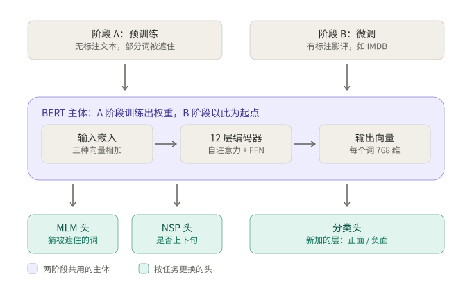

| 规模 | 层数 | 隐藏维度 | 注意力头 | 前馈中间层 | 参数量 |
|---|---:|---:|---:|---:|---:|
| BERT-base | 12 | 768 | 12 | 3072 | 约 1.1 亿 |
| BERT-large | 24 | 1024 | 16 | 4096 | 约 3.4 亿 |

## 1. 输入：一句话变成 6 列向量

1. **切词**：WordPiece 把生僻词拆成词片（如 `flightless` → `flight`、`##less`），句首加 `[CLS]`，每句末尾加 `[SEP]`。`bert-base-uncased` 的词表有 30,522 个词片。
2. **查三张表**，每行都是 768 维：词表（30,522 行，"这是什么词"）、位置表（512 行，"在第几个位置"）、句子表（2 行，"属于句子 A 还是 B"，单句任务全用 A）。
3. **三项逐维相加 → LayerNorm → dropout**，得到每个位置送进第 1 层的向量。

神经元视角：嵌入层就是一个全连接层。输入是三组 one-hot（共 30,522 + 512 + 2 = 31,036 个神经元），每组只有一个是 1，输出神经元的值等于三个亮着的神经元连过来的权重之和。所以"`love` 的词向量"就是 `love` 这个输入神经元连出去的那一排权重，"查表"只是省掉了乘 0 的计算。

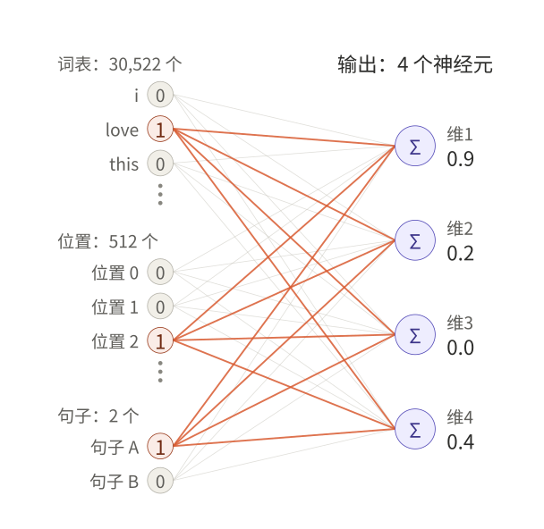

| | 维1 | 维2 | 维3 | 维4 |
|---|---:|---:|---:|---:|
| `love` 的词向量 | 0.8 | −0.2 | 0.1 | 0.5 |
| 位置 2 的向量 | 0.1 | 0.3 | −0.1 | 0.0 |
| 句子 A 的向量 | 0.0 | 0.1 | 0.0 | −0.1 |
| 相加 | 0.9 | 0.2 | 0.0 | 0.4 |
| LayerNorm 后 | 1.57 | −0.52 | −1.12 | 0.07 |

- 位置信息是**加**上去的，不是拼接，所以每个位置始终只有一个 768 维向量。原版 Transformer 用正弦公式算位置编码，BERT 直接学一张表。
- 位置表只有 512 行，第 513 个位置没有可以点亮的神经元，所以 BERT 最多处理 512 个 token，更长的评论只能截断或分段。
- 这一步的向量还不看上下文：`love` 在任何句子里都一样（和 GloVe 一样）。看上下文发生在后面 12 层。

## 2. 一层编码器：先交流，再消化

把 6 个词想成 6 个人开会，每人一张卡片（768 个数），每一层开一轮会：

- **① 交流（自注意力）**：每人举问题牌 q（"我想知道什么"），挂名牌 k（"我能回答什么"），拿发言稿 v（"轮到我时说什么"）。拿自己的 q 去对所有人的 k，越匹配越认真听，按认真程度把大家的 v 加权记下来，加到自己卡片上。
- **② 消化（前馈层）**：回到座位，只看自己的卡片独自想一想，列与列之间没有连线。

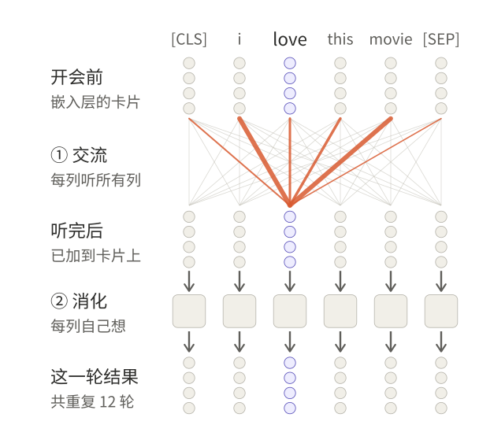

一层内部的完整顺序（12 层结构相同，权重各不相同）：

```
x（6×768）
├─ W_Q → q ┐
├─ W_K → k ├ 三个全连接并排，读同一个 x，中间没有激活
└─ W_V → v ┘
q·kᵀ/√64 → softmax              ← 注意力里的非线性
按权重加 v → 12 个头拼接 → W_O
加回 x → LayerNorm
全连接 768→3072 → GELU → 全连接 3072→768   ← 激活函数只在这里
加回 → LayerNorm → 交给下一层
```

Hugging Face 里每层的参数名就是这个顺序：`attention.self.query / key / value` → `attention.output.dense`、`attention.output.LayerNorm` → `intermediate.dense` → `output.dense`、`output.LayerNorm`。

### 2.1 全连接层：一个神经元 = 加权求和

一个神经元有和输入一样多的权重，只做一件事：输入的每个数乘对应的权重，全部加起来（再加偏置）。以 q 的第 1 个神经元为例，它的权重是 [−1, +1, −1, +1]：

$$
q_1 = w_1^{\mathsf T}x = (-1)(1.570) + (+1)(-0.523) + (-1)(-1.121) + (+1)(0.075) = -0.897
$$

把多个神经元的权重列并排就是权重矩阵，x 乘矩阵就是一次算完所有神经元：$q = W_Q^{\mathsf T}x$。PyTorch 的 `nn.Linear` 把权重存成（输出数, 输入数），算的是 `x @ W.T + b`，是同一件事。

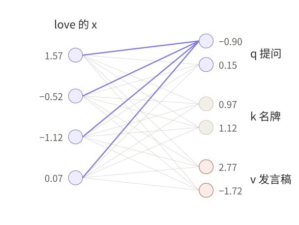

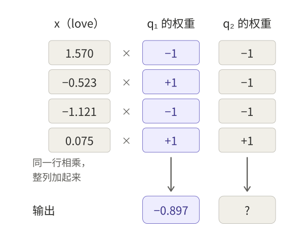

- q、k、v 是三个**并排**的全连接层，读同一个 x，互不依赖，所以实现上常拼成一个大矩阵一次算完（PyTorch `nn.MultiheadAttention` 的 `in_proj_weight`）。
- 中间没有激活：q、k、v 只是把 x 换三种说法；注意力本身已经是非线性的（q、k 都来自 x，打分相当于 x 和 x 相乘，后面还有 softmax）。
- W_Q、W_K、W_V 是训练出来的**参数**，换一句话也不变；q、k、v 是它们算出来的**输出**，每来一句话都重新算。

### 2.2 自注意力：打分 → 缩放 → softmax → 加权求和

$$
\mathrm{Attention}(Q,K,V)=\mathrm{softmax}\left(\frac{QK^{\mathsf T}}{\sqrt{d_k}}\right)V
$$

以 `love` 提问为例，q_love = [−0.90, 0.15]。玩具里每个头 2 维，所以除以 √2；BERT 每个头 64 维，除以 8。

| 词 | k | ① q·k | ② ÷√2 | ③ e^得分 | ④ 权重 | v |
|---|---|---:|---:|---:|---:|---|
| `[CLS]` | [2.04, 0.93] | −1.69 | −1.20 | 0.30 | 0.07 | [0.19, 1.30] |
| `i` | [−0.65, −0.65] | 0.49 | 0.34 | 1.41 | 0.31 | [0.32, −0.97] |
| `love` | [0.97, 1.12] | −0.70 | −0.50 | 0.61 | 0.13 | [2.77, −1.72] |
| `this` | [0.30, −1.51] | −0.50 | −0.35 | 0.70 | 0.15 | [−3.32, 2.71] |
| `movie` | [−0.21, 1.65] | 0.44 | 0.31 | 1.36 | 0.30 | [2.65, −1.93] |
| `[SEP]` | [2.66, 0.14] | −2.37 | −1.67 | 0.19 | 0.04 | [−1.26, 2.66] |

输出 = Σ 权重 × v = [0.71, −0.49]。表中的数是按未四舍五入的值算的，用两位小数手算会差 0.01 左右。

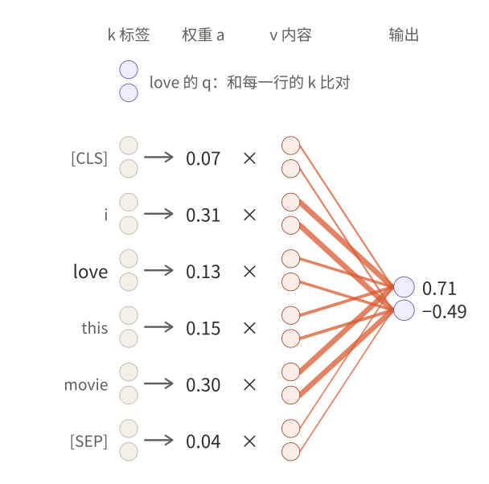

- **① 点积**：和 wᵀx 同一个运算，只是两边都是现算出来的向量；q 和 k 方向越一致，分数越大。
- **② 除以 √d_k**：d 个乘积相加，结果的标准差约为 √d（64 维时随机模拟得 8.00）。不除的话，玩具里的分数放大 8 倍，softmax 变成 `i` 0.56、`movie` 0.43、其余接近 0，几乎只听两个词，而且这时梯度很小，训练不动。
- **③④ softmax**：先取 e 的次方（负分也变成正数，大的变得更大），再除以总和，得到加起来等于 1 的权重。不能直接"分数 ÷ 总和"：分数有正有负，会出现负权重，总和还可能接近 0。
- **加权求和**：`love` 的输出里 31% 来自 `i`，30% 来自 `movie`，自己只占 13%。这和普通全连接不同：这里连线的粗细不是训练出来的参数，而是由这句话的 q、k 现算出来的。

6 列同时这样算，就得到一张 6×6 的权重表，每行加起来为 1：

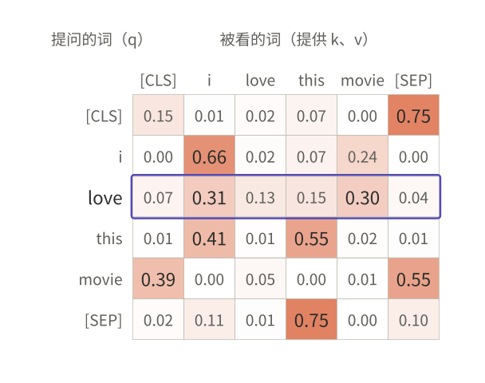

- 换 `movie` 提问，q 换了，整行权重都变（[0.39, 0.00, 0.05, 0.00, 0.01, 0.55]）；而每列的 k、v 只由那一列自己的 x 决定，谁提问都不变。
- **多头**：BERT-base 每层 12 个头，每个头有自己的 W_Q、W_K、W_V（各 768→64），各算一张表，各看各的关系；12 × 64 = 768 个数拼起来，再过 W_O（768→768）混合。玩具里有 2 个头，头 2 里 `love` 主要看 `this`（0.52）。

### 2.3 前馈层：每列自己消化

每一列各自过两层全连接：768 → 3072（GELU）→ 768。中间每个神经元像一个特征探测器，输入组合对上了就被点亮（输出正数），对不上 GELU 就把它压到 0 附近；第二层把被点亮的探测器各自"写回"的内容加起来。有研究把它看成一张键-值记忆表：第一层是键，第二层是值。

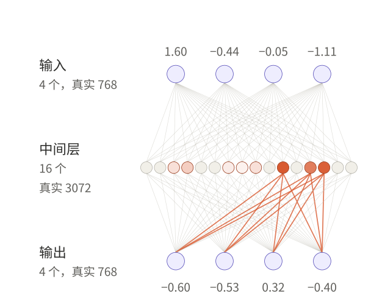

图中 `love` 这一列明显点亮了第 11、14、13 号神经元（1.11、1.07、0.86）。

"每列自己想"的实现：`nn.Linear` 只作用在最后一维，把 T 个位置当成 T 行，每行乘同一个矩阵。

```python
ffn = nn.Sequential(nn.Linear(768, 3072), nn.GELU(), nn.Linear(3072, 768))
out = ffn(x)                           # x: (B, T, 768) → out: (B, T, 768)
# 和逐列循环结果完全一样，只是快得多：
for t in range(T):
    out[:, t, :] = ffn(x[:, t, :])
```

IMDB 六模型里，TransformerNet 的 `self.proj = nn.Linear(300, 128)` 作用在 (b, 512, 300) 上，也是逐位置投影；它的 `nn.TransformerEncoderLayer(dim_feedforward=256)` 带一个 128 → 256 → 128 的前馈层（默认 ReLU）。玩具里把 `movie` 那一列改掉，`love` 的前馈输出完全不变，注意力输出则会变。

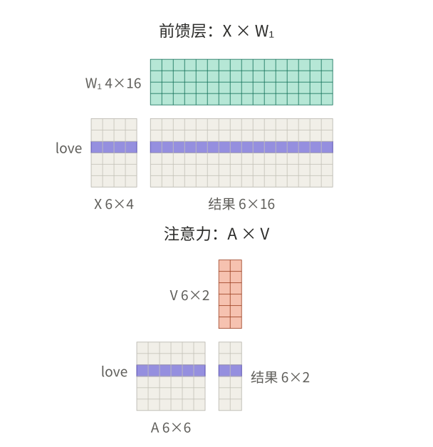

两者都是矩阵乘法，区别在乘在哪一边：权重矩阵乘在右边（X × W），只在同一个词自己的数之间混合；注意力表乘在左边（A × V），在不同的词之间混合。

为什么有了注意力还要前馈层：注意力的输出是各列 v 的加权平均，只是把已有的信息搬来搬去；前馈层用 GELU 给每一列做非线性变换，产生新的特征。一层里的激活函数只在这里。

### 2.4 残差与 LayerNorm

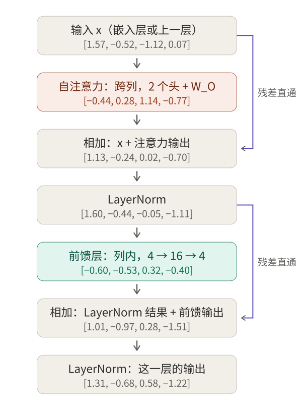

- **残差**：注意力和前馈的结果是加在原卡片上，不是替换。例如 [1.57, −0.52, −1.12, 0.07] + [−0.44, 0.28, 1.14, −0.77] = [1.13, −0.24, 0.02, −0.70]。好处是原信息不会在 12 层里被冲掉，反向传播时梯度也能顺着直通线往回走，深层才训得动。
- **LayerNorm**：每次相加后，把这一列的数拉回均值 0、标准差 1，再乘、加两个可训练的 γ、β（玩具取 1、0），防止数越加越大。它只在一列内部做，不跨列。BERT 是先相加再 LayerNorm（Post-LN）。
- 每层输出和输入形状一样（6×768），所以能直接送进下一层；12 层各有各的权重。

## 3. 完整数据流与形状

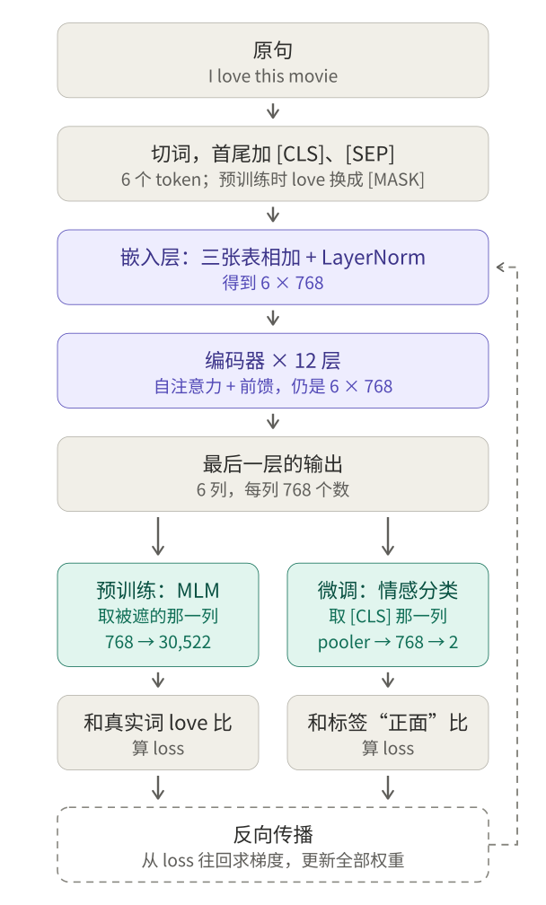

```
input_ids                    (B, T)            每个位置一个词片编号
嵌入层                       (B, T, 768)
12 层编码器                  (B, T, 768)       形状不变，只改数字
分类：取第 0 列 [:, 0, :]     (B, 768)          T 这一维在这里消失
  pooler（768→768，tanh）    (B, 768)
  分类头（768→2）            (B, 2)
MLM：每个位置都过 MLM 头      (B, T, 30522)     即 (B, T, V)，V 为词表大小
```

**`[CLS]` 为什么能代表整句**：一句话只要一个答案，模型必须把 (B, T, H) 变成 (B, H)。IMDB 六模型各有做法：

| 模型 | 去掉 T 这一维的做法 |
|---|---|
| CNN | `F.max_pool1d`，沿 t 取最大值 |
| LSTM / GRU | `torch.cat([states[0], states[-1]])`，拼接第一步和最后一步 |
| AttLSTM | `att_out.sum(dim=0)`，按注意力权重加权求和 |
| TransformerNet | `x.mean(dim=1)`，沿 t 求平均 |
| BERT | `x[:, 0, :]`，直接取 `[CLS]` 那一列 |

`[CLS]` 没有自己的词，在 12 层里每层都通过注意力听了所有词；微调时 loss 只从这一列进入网络，逼它把对分类有用的信息收集起来。所以它的"总结"是在 12 层里一边开会一边做的，不是最后才平均。`AutoModelForSequenceClassification` 内部就是这样取 `[CLS]` 的。

(B, T, V) 是 MLM 头的输出：每个位置都对词表里每个词打分，T 这一维还在。算交叉熵时摊平成 (B·T, V) 只是为了方便，不是在总结整句。

## 4. 训练：前向改 x，反向改参数

- **前向**：12 层改的是每个词的向量 x。到最后，`love` 那一列已经不是嵌入表里"字典里的 love"，而是混进了 `i`、`this movie` 信息的"放在这句话里的 love"。
- **反向传播**：从 loss 出发沿原路往回求梯度，改的是**参数**：W_Q、W_K、W_V、W_O、前馈两层、LayerNorm 的 γ 和 β、三张嵌入表、pooler 和头。应该说"W_Q 的参数"，而不是"q 的参数"。
- MLM 的 loss 只在被遮的那一列算，但梯度会顺着注意力的连线流回其他所有列，所以 W_Q、W_K 被逼着学会"让被遮的那一列去听对猜词有用的列"，W_V 学会该交出什么内容。注意力权重之所以有意义，是被 loss 训练出来的。

## 5. 预训练的两道题：MLM 与 NSP

两道题是练习，目的不是会做这两种题，而是逼主体在做题过程中练出"懂语言"的能力。练完扔掉答题卡（两个头），留下主体。

**为什么要遮词**：编码器里每个词都能看到所有词。如果直接让它预测"这个位置是什么词"，答案就在输入里，模型直接抄就能得到很低的 loss，什么也学不到。BERT 论文的说法是，双向条件会让每个词间接"看到自己"。解决办法是把答案从输入里拿掉，换成 `[MASK]`，原词留作标签。

| | MLM（Masked Language Model，遮词填空） | NSP（Next Sentence Prediction，下一句预测） |
|---|---|---|
| 输入 | 随机选 15% 的位置；其中 80% 换成 `[MASK]`、10% 换成随机词、10% 不变 | `[CLS] A [SEP] B [SEP]`；50% 的 B 是真正的下一句，50% 随机抽取 |
| 例子 | `[CLS] i [MASK] this movie [SEP]` → 猜出 `love` | A = i love this movie；B = the acting is great → 是；B = the stock market fell today → 否 |
| 用哪一列 | 被选中的那些列 | `[CLS]` 那一列（经 pooler） |
| loss | 只在被选中的位置算，没被选中的位置答案就在输入里 | 二分类交叉熵 |
| 练什么 | 词级：每个词在上下文里的意思 | 句级：两句话的关系，也让 `[CLS]` 学会做总结 |
| 后来的发现 | BERT 的核心 | RoBERTa 去掉 NSP 后效果持平或略好；ALBERT 认为它太简单（随机句子往往话题不同，只看话题就能答对），改成判断两句顺序是否被调换 |

80/10/10 的原因：微调和使用时输入里从来没有 `[MASK]`。如果被选中的词全换成 `[MASK]`，模型只在看到 `[MASK]` 时才认真理解，练习和考试不一致。混入随机词和原词后，模型分不清哪些可见的词是真的，只好给每个位置都算出好的表示。

## 6. 三个容易混的"头"与 `[CLS]`

| | 是什么 | 训练时 |
|---|---|---|
| `[CLS]` | 输入里的一个特殊 token，自己占一列，和其他词一起在 12 层里被更新 | 这一列的数值每句话都重算；它在词表里的那一行嵌入是参数 |
| 输出头（任务头） | 接在主体最上面的小网络，把某一列的 768 个数翻译成答案 | 参数，被反向传播更新 |
| 注意力头 | 每层内部 12 组并排的 q、k、v，各算一张权重表 | 它们的 W 是参数 |

`[CLS]` 是被头读取的那一列，头是读它的那个小网络。

加载日志里的 UNEXPECTED / MISSING：检查点里有、当前模型用不上的叫 UNEXPECTED，直接丢掉；当前模型需要、检查点里没有的叫 MISSING，新建后随机初始化，必须在微调中训练。

| 模型 | UNEXPECTED（预训练头，丢掉） | MISSING（新建，随机初始化） |
|---|---|---|
| bert-base-uncased | `cls.predictions.*`（MLM 头）、`cls.seq_relationship.*`（NSP 头） | `classifier.weight/bias` |
| deberta-v2-xxlarge | `lm_predictions.lm_head.*`（MLM 头） | `pooler.dense.*`、`classifier.*` |

`cls.predictions` 里的 `cls` 是 Hugging Face 给预训练头模块起的名字，和 `[CLS]` token 无关。BERT 的 pooler 由 NSP 训练过，所以在检查点里，会被正常加载；DeBERTa 的检查点没有 pooler，所以它和分类头一起被新建、一起训练。

## 7. 参数账：bert-base-uncased + 二分类头

| 部分 | 构成 | 参数量 |
|---|---|---:|
| 嵌入层 | 词表 30,522×768 = 23,440,896；位置 512×768 = 393,216；句子 2×768 = 1,536；LayerNorm 1,536 | 23,837,184 |
| 每层编码器 | Q、K、V、O 各 768×768+768 = 590,592（共 2,362,368）；前馈 768×3072+3072 = 2,362,368 与 3072×768+768 = 2,360,064；两个 LayerNorm 各 1,536 | 7,087,872 |
| 12 层 | 7,087,872 × 12 | 85,054,464 |
| pooler | 768×768+768 | 590,592 |
| 主体合计 | | 109,482,240 |
| 分类头 | 768×2+2 | 1,538 |
| **总计** | 与 Kaggle 日志一致 | **109,483,778** |

预训练头：MLM 头 622,650（768×768+768 的变换层、LayerNorm 1,536、30,522 个输出偏置；输出矩阵和词表共用权重），NSP 头 1,538。

LoRA 的可训练参数（r = 8，只加在 query、value 上）：

- BERT：12 层 × 2 个矩阵 × 8 × (768 + 768) = 294,912，加分类头 1,538，共 296,450，占全部 109,780,228 的 0.27%，与日志一致。
- DeBERTa-v2-xxlarge（48 层，隐藏维度 1536）：48 × 2 × 8 × (1536 + 1536) = 2,359,296，加 pooler 2,360,832 和分类头 3,074，共 4,723,202，与日志一致。

## 8. BERT 的思想与前后模型对比

三句话：

1. 先用海量无标注文本把**整个网络**练成"懂语言"，再用少量标注数据微调。
2. 要**深层双向**：每一层、每个词都同时看左右两边。
3. 双向又不能泄露答案，所以遮词让它猜（MLM）。

| 模型 | 预训练任务 | 一个词能看到什么 |
|---|---|---|
| GloVe | 统计词和词的共现 | 不看上下文，每个词一个固定向量 |
| ELMo | 两个 LSTM，一个从左读、一个从右读 | 两个方向各读各的，最后才拼起来（浅层双向） |
| GPT | 预测下一个词 | 只能看左边 |
| BERT | MLM + NSP | 每一层都同时看左右（深层双向） |

| | 原版 Transformer | BERT |
|---|---|---|
| 结构 | 编码器 + 解码器 | 只有编码器 |
| 用途 | 翻译：解码器一个词一个词往外生成 | 理解：每个词得到带上下文的向量 |
| 训练 | 用翻译句对从头训练 | 无标注文本预训练，再微调 |
| 看的方向 | 解码器只能看左边（因果遮挡） | 每个词左右都能看 |
| 两句话怎么处理 | 解码器用交叉注意力看编码器的输出 | 拼成一个序列 `[CLS] A [SEP] B [SEP]`，用同一套自注意力，靠句子嵌入区分 |
| 位置信息 | 正弦公式 | 学一张 512 行的表 |
| 其他 | ReLU；base 版编码器、解码器各 6 层，512 维 | GELU；12 层，768 维 |

## 9. 我的 IMDB 实验对照

三个预训练模型由同一份 Notebook 依次训练（分层划分 20,000 训练 / 5,000 验证，3 轮，学习率 2e-5，按验证 AUC 选轮次），详见 [IMDB 目录](../../实验/IMDB/README.md) 和 [实验结果汇总](../../实验结果汇总.md)。

| 模型 | 可训练参数 | 验证 accuracy | 验证 AUC | Kaggle AUC |
|---|---:|---:|---:|---:|
| GloVe（冻结）+ BiGRU，六模型最好 | — | 0.9031（batch 平均） | — | 0.89996（提交 0/1 标签） |
| BERT 全量微调 | 109,483,778 | 0.9206 | 0.9741 | 0.97522 |
| BERT LoRA | 296,450 | 0.8766 | 0.9497 | 0.95315 |
| DeBERTa-v2-xxlarge LoRA | 4,723,202 | 0.9334 | 0.9800 | 0.98294 |

- Kaggle 按 ROC-AUC 评分。六模型提交的是 0/1 标签，这时 AUC 等于（真正率 + 真负率）/ 2，接近准确率；预训练模型提交的是正类概率。所以 0.89996 和 0.975 不能直接相减。按准确率看，BERT 全量（验证 0.9206）比 GloVe 最好的模型（约 0.90）大约高 2 个点，两者的验证划分不同，只能作量级参考。
- BERT LoRA 比全量低约 0.02 AUC。它沿用了全量微调的学习率 2e-5，而 LoRA 论文给 RoBERTa-base 的 LoRA 用的是 4e-4 到 5e-4，它的验证 AUC 到第 3 轮仍在上升。学习率偏小、训练不足是候选解释，还没有用实验验证。
- DeBERTa-v2-xxlarge 最好，但底座、分词方式和截断长度（128）都和 BERT 不同，差距不能全部归因于 LoRA；它在单张 T4 上训练了约 2 小时。

## 10. 易混点

| 我的理解 | 更正 |
|---|---|
| q 是给别人用的，k 是自己的 | 三者都由自己的 x 算出：拿自己的 q 去配所有人的 k，被选中时交出自己的 v |
| v 是这一层的最终输出 | 输出是各列 v 按权重的加和，之后还要经过 W_O、残差、LayerNorm 和前馈层 |
| 多个句子用交叉注意力 | 交叉注意力只在编码器-解码器结构里；BERT 把两句拼成一个序列，用同一套自注意力 |
| q、k、v 是三层的参数 | W_Q、W_K、W_V 是参数；q、k、v 是每句话现算的输出 |
| 先前馈再算 softmax | 每层先注意力（q、k、v、softmax），再前馈 |
| 前向传播在更新参数 | 前向只改每个词的向量 x；参数只在反向传播后更新 |
| 头就是 `[CLS]` | `[CLS]` 是一列数据，头是读这一列的小网络 |

## 参考

- Devlin 等，*BERT: Pre-training of Deep Bidirectional Transformers for Language Understanding*，[arXiv:1810.04805](https://arxiv.org/abs/1810.04805)
- Vaswani 等，*Attention Is All You Need*，[arXiv:1706.03762](https://arxiv.org/abs/1706.03762)
- Liu 等，*RoBERTa*，[arXiv:1907.11692](https://arxiv.org/abs/1907.11692)；Lan 等，*ALBERT*，[arXiv:1909.11942](https://arxiv.org/abs/1909.11942)
- Peters 等，*ELMo*，[arXiv:1802.05365](https://arxiv.org/abs/1802.05365)；Radford 等，*GPT*，[论文 PDF](https://cdn.openai.com/research-covers/language-unsupervised/language_understanding_paper.pdf)
- Geva 等，*Transformer Feed-Forward Layers Are Key-Value Memories*，[arXiv:2012.14913](https://arxiv.org/abs/2012.14913)
- Hendrycks、Gimpel，*GELU*，[arXiv:1606.08415](https://arxiv.org/abs/1606.08415)
- 本笔记由 Claude 根据与学习者的问答整理；玩具数字由 [toy_bert.py](toy_bert.py) 生成。
